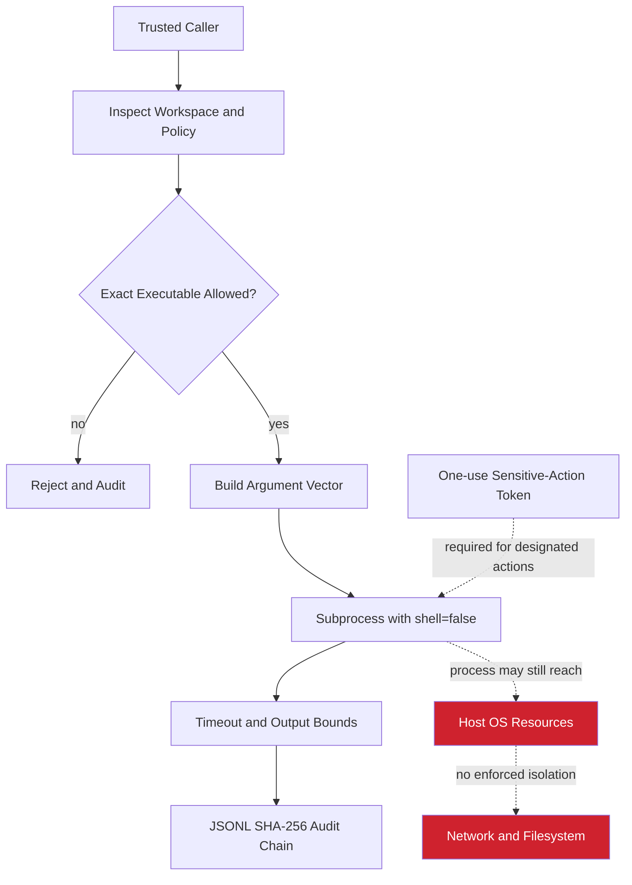
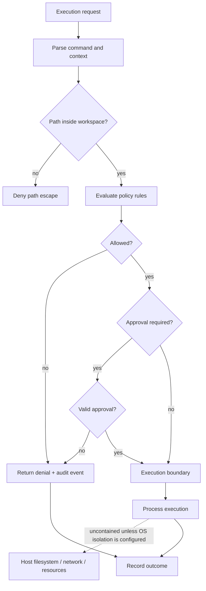

# x4-sandbox

Policy-gated, auditable process execution for X4 agents.

**Security:** process mode is not an OS sandbox and is not suitable for hostile code.
It cannot enforce network denial or hard CPU, memory, disk, or filesystem quotas. The
default network-deny policy blocks execution unless the caller explicitly acknowledges
the limitation. That override does not disable network access and must not be used for
untrusted workloads.

## Install and verify

Requires Python 3.11+.

    python -m pip install -e .
    python -m pip install pytest ruff
    pytest
    ruff check .

## Inspect without executing

    x4-sandbox inspect --workspace ./workspace --allow python git

## Trusted command example (unsafe acknowledgement)

Only for trusted code in a controlled environment:

    x4-sandbox run --workspace ./workspace --allow python --acknowledge-unenforced-network -- python --version

<!-- X4-APEX-DIAGRAM-START:x4-sandbox -->

<!-- X4-APEX-DIAGRAM-END:x4-sandbox -->

## Implemented

- Exact executable allow-list and argument-vector execution with shell=False
- Blocks common shell command-string flags
- Timeout and captured-output bounds
- Environment variable allow-list and NUL rejection
- Workspace cwd and JSONL SHA-256 hash chain
- One-use approval tokens for caller-designated sensitive SDK operations\n- Fail-closed default for unsupported network-deny guarantee
- CLI inspect/run commands and CI tests

## Not implemented

OS-enforced network isolation, child-process filesystem isolation, hard CPU/memory/disk
quotas, Windows Job Objects, containers, microVMs, approval service, REST/MCP APIs,
cloud providers, or cryptographic signatures. Use a real OS/container boundary before
executing untrusted code.

## APEX Architecture Map

> Status: architecture documentation; implementation and deployment claims require independent verification.

**Security boundary:** Policy checks are not equivalent to OS-level isolation. Verify process, network, filesystem, and resource controls before calling this a secure sandbox.

